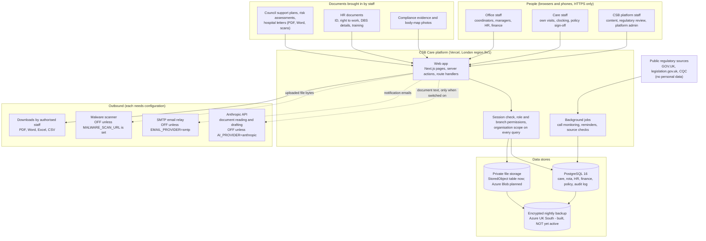

# Data flow

> **DRAFT FOR HUMAN REVIEW.** Drafted from the code and deployment documents on 10 November 2026. Hosting details
> must be confirmed against the live Vercel and database accounts before this is relied on.

## Summary

CSB Care is one Next.js application and one PostgreSQL database. Every organisation's records sit in the same
database and are separated by an `organisationId` on each row. Uploaded files are kept in private storage (a database
table on the current Vercel deployment). Personal data leaves the platform only through the routes listed under
"Outbound flows" below, and most of those are switched off by default.

## Diagram

## Who the data is about

| Group | Examples of data | Special category? |
| --- | --- | --- |
| Service users (people receiving care) | Name, date of birth, address, key-safe code, NHS and council reference numbers, care plans, risk assessments, medication records, incidents, body-map observations and photos, visit notes, call notes | Yes: health; may include ethnicity, religion and safeguarding information |
| Service users' contacts | Name, relationship, phone, email, address, recorded legal authority (LPA, deputy) | No, but linked to a person's health record |
| Staff and job candidates | Identity, contact details, employment history, right-to-work and DBS check results, training, absence (may include sickness), pay rates, timesheets, visit clock times | Partly: sickness absence is health data; DBS results are criminal-offence data |
| Platform users | Email, name, password hash, sign-in attempts, session records, actions in the audit log | No |

## Stores

| Store | What it holds | Location today | Notes |
| --- | --- | --- | --- |
| PostgreSQL 16 | All structured records, the audit log, the job queue, HR workspaces (one JSON document per organisation) | **[OWNER] confirm.** `docs/DEPLOYMENT.md` describes Supabase (London); `docs/OPERATIONS.md` describes the Neon integration on Vercel. Only one is live. | One database for all organisations; isolation by `organisationId`, with row-level security planned as a second layer |
| File storage | Uploaded council documents, evidence, body-map photos, HR files | `StoredObject` table in the same database on Vercel | `STORAGE_PROVIDER` can move this to Azure Blob or Supabase Storage |
| Encrypted fields | Key-safe codes; council, Frameworki and NHS reference numbers | Same database, AES-256-GCM with `CSB_REFERENCE_SECRET` | `src/server/care/keysafe.ts`, `src/server/care/external-references.ts` |
| Backups | Nightly encrypted dump | Azure UK South (planned) | Built in PR #118, **not active** until the runner, storage and keys exist (`docs/BACKUPS.md`) |
| Logs | Structured application logs | Vercel log storage (short retention on the current plan) | Secrets are redacted; a test that care-record fields are redacted is part of the operations workstream |

## Outbound flows

| To | Data | When | Control |
| --- | --- | --- | --- |
| Anthropic (AI provider, United States) | Text of uploaded documents and prompts | Only when an administrator sets `AI_PROVIDER=anthropic` and a key | Off by default. `simulated` and `none` send nothing. Output is a proposal a person must accept. **This is an international transfer and needs a processor agreement and a transfer assessment before use with real records.** |
| SMTP relay | Recipient address, subject, message text | Only when `EMAIL_PROVIDER=smtp` | Default `log` keeps messages in the database outbox only |
| Malware scanner | Bytes of an uploaded file | Only when `MALWARE_SCAN_URL` is set | Without it files are labelled "Not virus-checked" |
| Staff downloads | Reports, printable rotas, MAR charts, policies, evidence | When an authorised person clicks download | Permission check on the server and an audit log entry for each |
| Public regulatory sites | Requests for public pages; **no personal data** | Scheduled source monitoring | Robots rules respected |

There is no outbound flow to CQC, a local authority, a GP system, a pharmacy, HMRC, a payroll provider or a funder.
The platform prepares figures and reminders; a person sends anything that needs sending.

## Processors and sub-processors to confirm **[OWNER]**

| Supplier | Role | Region to confirm | Agreement in place? |
| --- | --- | --- | --- |
| Vercel | Application hosting and logs | Functions in London (`lhr1`); account and log storage region to confirm | **[OWNER]** |
| Supabase or Neon | Managed PostgreSQL | London region expected; confirm in the account | **[OWNER]** |
| GitHub | Source code and CI (synthetic data only) | Global | **[OWNER]** |
| Microsoft Azure | Backups now, full hosting later | UK South | **[OWNER]** |
| Anthropic | AI document reading, if switched on | United States | **[OWNER]** |
| Email relay (not chosen) | Notification email, if switched on | To choose | **[OWNER]** |
| Error tracking (proposed, not installed) | Error reports with personal fields removed | EU region proposed | **[OWNER]** |

## Trust boundaries

1. **Browser to platform.** HTTPS only (HSTS). The session cookie is HttpOnly, SameSite=Lax and Secure in production.
2. **Platform to database.** One pooled database role today. Planned: a non-superuser role with row-level security.
3. **Organisation to organisation.** `organisationId` from the server-side session on every query, never from the
   request. Cross-tenant tests in `tests/integration`.
4. **CSB platform staff to tenant data.** Platform roles act on central content; access to a tenant's records goes
   through time-limited `SupportAccessGrant`s in the Platform Admin Centre.
5. **Platform to third parties.** Only the outbound flows above.
