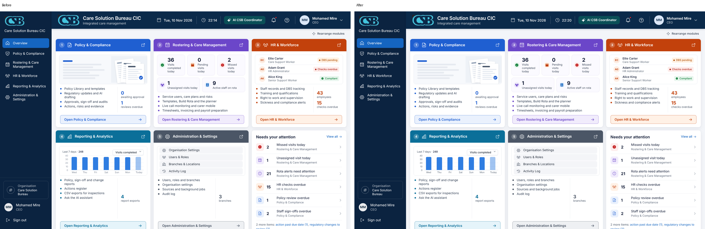
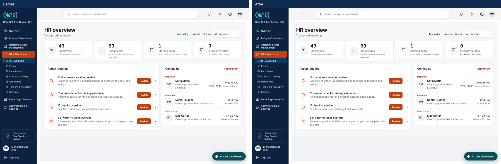

# UX responsiveness audit

Workstream 5 of the enterprise-readiness brief (10 November 2026). Every page under `src/app`, how much database work
it does, and what a person sees while it loads, when it fails and when it has nothing to show. Then what was changed,
and what was deliberately left alone.

## How this was measured

- **Where:** a production build (`next build`, `next start`) on a local PostgreSQL 16 with the demo seed (two
  organisations, about 45 staff, 12 service users, 167 policies). Never the live site.
- **Who:** the demo organisation admin (`manager@care-solution.demo`) for the care platform and the platform
  administrator (`admin@csb.demo`) for the Admin Centre.
- **How:** a crawler opened every page reachable from the menus and from links on those pages (two levels deep), and
  read PostgreSQL's own statement log for each page view (`log_min_duration_statement = 0`). 141 of the 174 pages were
  reached; the other 33 need a role, a record or a state the demo admin does not have (the carer app, the sign-in
  pages, a client just created) and are marked "not measured".
- **Columns:** *Queries* and *Database time* are everything the page and the shell around it sent to the database for
  one view. *Slowest query* is the single slowest statement and the table it read. *Server response* is the time to the
  full HTML on the same machine (no network).
- **Limits of this measurement:** demo volumes are small. A query that takes 0.4 ms on 167 policies says little about
  20,000. Query *count* is the number that carries over to a real hosted database, where each round trip costs 1 to
  5 ms of network time on its own.

## What it found

1. **No slow query.** The slowest single statement on any page was 8.7 ms. There is no measured case for a new
   database index at this size, so none was added (an index nobody needs slows every write). The tables to watch as
   data grows are `Visit`, `VisitAssignment`, `AuditLog` and `Acknowledgement`; all four already have indexes on
   organisation with a date or state.
2. **The cost is the number of round trips, not their speed.** The shell (session, organisation, menus, alerts) costs
   about 23 queries on every page before the page does anything. 19 pages send more than 50. The fifteen heaviest:

   | Page | Queries | Database time | Server response |
   | --- | ---: | ---: | ---: |
   | `/rota/templates/[id]` | 275 | 14 ms | 346 ms |
   | `/rota/visits/[id]` | 105 | 13 ms | 210 ms |
   | `/policies` | 101 | 9 ms | 208 ms |
   | `/rota/coordinator/[id]` | 80 | 4 ms | 191 ms |
   | `/rota/coordinator/shift` | 80 | 4 ms | 191 ms |
   | `/` | 78 | 4 ms | 128 ms |
   | `/rota/attention` | 78 | 5 ms | 236 ms |
   | `/rota/build` | 71 | 4 ms | 159 ms |
   | `/rota/service-users/[id]` | 69 | 3 ms | 147 ms |
   | `/rota/staff/[id]` | 68 | 11 ms | 167 ms |
   | `/rota` | 65 | 7 ms | 206 ms |
   | `/rota/missed/[id]` | 63 | 2 ms | 148 ms |
   | `/analytics` | 62 | 7 ms | 123 ms |
   | `/platform-admin` | 61 | 2 ms | 77 ms |
   | `/compliance/cqc` | 60 | 2 ms | 142 ms |

   The pattern behind the heaviest is the same: the staff eligibility check (about 30 queries) runs once per week or
   once per visit instead of once per page. `/rota/templates/[id]` planned every built week again just to count
   missing visits (7 weeks, 275 queries).
3. **Loading states.** Every page inside the signed-in shell already has one, from the shell itself
   (`docs/implementation/UI_MOTION_AND_NAVIGATION.md`): the sidebar moves to the page asked for at once, a progress bar
   starts after 120 ms, and after 450 ms a placeholder in the shape and colour of the page being opened replaces the
   old one. The Platform Admin Centre had none of this.
4. **Error screens.** Every page has one. Pages in the shell use `(app)/error.tsx` (keeps the menus, real retry);
   the Policy Library has its own. Admin Centre pages fell through to the whole-site error screen, which points people
   at the care platform.
5. **Empty states.** Found on 154 pages by reading the page and the components it imports. The 20 marked "not found"
   are forms, redirects and single-record pages where an empty list cannot occur, plus the HR Hub (its screens are
   client-rendered and carry their own). None was found missing where a list can be empty.
6. **Forms.** Every form in the shell shows a spinner on the pressed button and ignores a second click. A second
   submission by keyboard (Enter twice) was **not** stopped: the action ran twice.
7. **Lists without a limit.** 89 `findMany` calls in page files have no `take`. 85 of them read small, bounded sets
   (branches, categories, the members of one organisation, names for ids already on the page). Four read lists that
   grow: audits, corrective actions, the drafts queue and a person's own sign-offs.

## What was changed

| Change | Where | Why |
| --- | --- | --- |
| Acceptance test: visible feedback within 200 ms of pressing a primary action on Overview, Rota, Service Users, HR Hub and Policies, measured in the page with the server held back 1.5 s | `tests/e2e/feedback-200ms.spec.ts` | The brief's acceptance test. 16 actions; the slowest answers in 147 ms |
| A form submitted twice while the first is still with the server runs once | `src/components/navigation-progress.tsx` | Finding 6. Tested by creating a corrective action with two submissions and finding one |
| The Admin Centre has the same progress bar, button spinner and double-submit protection as the care platform | `src/app/(platform)/layout.tsx` | Finding 3 |
| The Admin Centre has its own error screen with a real retry, inside its own frame | `src/app/(platform)/error.tsx` | Finding 4 |
| The "visits missing from built weeks" check on a visit template streams in after the page (React Suspense) | `src/app/(app)/rota/templates/[id]/page.tsx` | Finding 2: the heaviest page. The template is on screen without waiting for 250 queries |
| Audits and corrective actions are paged, 50 to a page, with the existing footer | `src/app/(app)/audits/page.tsx`, `actions/page.tsx` | Finding 7. Each audit row carried all its answers |
| The document viewer's "Download PDF" link in its error message is underlined | `src/components/library/document-viewer.tsx` | It was told apart from the red text around it by colour alone |
| Greys below WCAG AA contrast darkened to greys already used elsewhere | `src/app/(app)/hr/hr-ui.css` (HR tile notes) | Lighthouse accessibility, see below. The same fix to the old Overview chart's axis labels was dropped when the Overview was rebuilt (#140, #141), which removed that chart |

## What was deliberately not changed

- **No `loading.tsx` per section.** A `loading.tsx` shows its skeleton the instant a link is pressed, which would
  replace the approved behaviour (keep the old page for 450 ms so a fast page never flashes) with a flash on every
  click, and it would need a second copy of every skeleton the shell already draws. The shell's placeholders are
  section-shaped already. Recorded as a decision for the owner in the pull request.
- **No blanket `useOptimistic`.** Server actions here redirect back with `?ok=` or `?error=` and the page re-renders
  from the database, so the screen never shows a change the server refused. In care records that is the safer
  behaviour. The pressed control shows it is working within 15 ms, which is what the 200 ms test measures.
- **No toast component.** Every mutation already ends in a `<Flash>` message (`role="status"` or `role="alert"`) from
  the server's answer. A second, client-side toast would be a new component style (design freeze) and could say
  "saved" before the server agreed.
- **Page background and padding.** Done by the approved colour redesign (pull requests #134 to #137, merged into
  `main` on 10 November and into this branch): one `#f6f7fa` page frame with one set of padding tokens in
  `tailwind.config.ts`. Nothing further was needed here.
- **Type scale.** Done in its own pull request after the five enterprise readiness pull requests were merged (owner's decision, 10 November). One scale of 11 sizes in `tailwind.config.ts`: `micro` 11, `caption` 12, `meta` 13, `body` 14, `lead` 16, `subtitle` 18, `title` 20, `heading` 22, `display` 24, `figure` 28 and `figure-lg` 36 px. The tokens set the size only, so no line height or spacing changed. About 3,100 fixed sizes in 268 files and 66 in `globals.css` were moved to the nearest step: half sizes round up (12.5 to 13, 13.5 to 14, 15 to 16), with 14.5 rounding down to 14. The exceptions are the sidebar, which rounds down (13 for sections, 12 for pages) so menu names still fit, and two oversized figures that are left as they were (52 px on the Overview, 34 px on the CQC rating). The HR Hub is not touched: its CSS is prebuilt and out of scope.
- **The HR Hub's two large files** (`src/hr/components/hub.tsx`, `workspace-widgets.tsx`). `CLAUDE.md` says not to
  restructure the HR Hub; the brief says to split them. The owner has been asked which applies.
- **The eligibility check running once per week or visit** (finding 2). It is the rota's core safety rule; batching
  it changes the rota build's code path and needs its own change with its own tests. Listed in
  `KNOWN_LIMITATIONS.md`.
- **The drafts queue and a person's own sign-offs** stay unpaged: they are work lists, and hiding open work on page 2
  is worse than a long page. Both are bounded by open work, not by history.
- **The Policy Library viewer's toolbar buttons** (17 px wide at 1440, 24 px required) and one low-contrast label
  on the same screen: the toolbar needs laying out again, which the design freeze rules out here. The orange
  "Late calls" tile on the Rota Dashboard, listed here earlier, was fixed by the colour redesign.
- **One small tap target in the shared top bar on a phone** (it arrived with the colour redesign and is the same
  before and after this change). It costs three accessibility points on a phone on four of the five pages.

## Lighthouse

> The Overview was rebuilt in `main` (#140, then made more compact in #141) after these measurements. The Overview rows and picture below are of the earlier Overview and are kept as the record of what was measured; this branch no longer changes the Overview.

Lighthouse 13.6, run from outside the repository (it is not a dependency), signed in, against the local production
build. "Desktop" is Lighthouse's desktop preset. "Mobile" is its default: a mid-range phone on slow 4G with the
processor slowed four times. Measured again on 10 November after the colour redesign (#134 to #137, #139) was
merged in: "before" is `main` with the redesign, "after" is this branch on top of it.

| Page | Desktop performance | Desktop accessibility | Mobile performance | Mobile accessibility |
| --- | --- | --- | --- | --- |
| Overview | 100 → 100 | 96 → 100 | 91 → 90 | 96 → 100 |
| Rota Dashboard | 100 → 100 | 100 → 100 | 89 → 88 | 97 → 97 |
| Service Users | 100 → 100 | 100 → 100 | 91 → 92 | 97 → 97 |
| HR Hub | 98 → 98 | 96 → 100 | 78 → 77 | 93 → 96 |
| Policy Library | 99 → 99 | 94 → 94 | 78 → 78 | 97 → 97 |

Before → after. Read these honestly:

- **Desktop meets the 90+ target on all five pages**, before and after. Accessibility rose to 100 on the Overview and
  the HR Hub (the contrast fixes). The Policy Library stays at 94 on desktop (viewer toolbar buttons and one
  low-contrast label, see above).
- **Mobile performance did not change** (differences of one or two points between runs are noise) and **is below 90
  on three pages**: 88 on the Rota Dashboard, 77 to 78 on the HR Hub and Policy Library. Nothing in this workstream made the first load on a
  slow phone lighter. What would: splitting the HR Hub so the dashboard does not download the whole workspace (one
  265 KB request and one script, 88% of it unused on that screen), and loading the Policy Library's document viewer
  (130 KB, 84% unused at first paint) only when a document is opened. The office uses this on desktops; carers use
  `/carer`, which was not one of the five pages.
- **Mobile accessibility** is 100 on the Overview and 96 to 97 elsewhere. What is left is the top-bar tap target above.
- Lighthouse measures a first, cold page load. The 200 ms test above measures what people feel when they click
  inside the app, which is the commoner case.

## Before and after screenshots

43 screenshots were taken before and after on the same data (33 pages at 1440 wide, and the five main pages at 834
and 390), on the new colour system, then compared pixel by pixel. 33 are identical. The ten that differ are the
Overview (chart axis labels, three widths), the HR Hub dashboard (tile notes, three widths), and the Rota Dashboard
(three widths) and Needs Attention, where under 0.05% of pixels differ because the clock and "minutes late" figures
moved on in the six minutes between the two runs. Nothing moved.

## Every page

| Page | Queries | Database time | Slowest query | Server response | Loading state | Error screen | Empty state |
| --- | ---: | ---: | --- | ---: | --- | --- | --- |
| `/` | 78 | 4 ms | 0.4 ms on `Policy` | 128 ms | shell skeleton | `(app)/error.tsx` | yes |
| `/account/[token]` | not measured |  |  |  | none (static form) | `error.tsx` | not found |
| `/acknowledgements` | 35 | 1 ms | 0.2 ms on `Acknowledgement` | 102 ms | shell skeleton | `(app)/error.tsx` | yes |
| `/actions` | 37 | 2 ms | 0.2 ms on `Membership` | 128 ms | shell skeleton | `(app)/error.tsx` | yes |
| `/actions/[id]` | 26 | 1 ms | 0.1 ms on `Policy` | 98 ms | shell skeleton | `(app)/error.tsx` | yes |
| `/admin/areas` | 24 | 1 ms | 0.2 ms on `Membership` | 105 ms | shell skeleton | `(app)/error.tsx` | yes |
| `/admin/audit` | 23 | 2 ms | 0.4 ms on `AuditLog` | 158 ms | shell skeleton | `(app)/error.tsx` | yes |
| `/admin/branches` | 25 | 4 ms | 3.5 ms on `HrWorkspace` | 105 ms | shell skeleton | `(app)/error.tsx` | yes |
| `/admin/jobs` | 9 | 1 ms | 0.4 ms on `BackgroundJob` | 111 ms | shell skeleton | `(app)/error.tsx` | yes |
| `/admin/readiness` | 25 | 2 ms | 0.5 ms on `Policy` | 139 ms | shell skeleton | `(app)/error.tsx` | yes |
| `/admin/sources` | not measured |  |  |  | shell skeleton | `(app)/error.tsx` | not found |
| `/admin/sources/[id]` | not measured |  |  |  | shell skeleton | `(app)/error.tsx` | yes |
| `/admin/users` | 24 | 1 ms | 0.2 ms on `Membership` | 131 ms | shell skeleton | `(app)/error.tsx` | yes |
| `/admin/workforce` | 22 | 1 ms | 0.2 ms on `Policy` | 121 ms | shell skeleton | `(app)/error.tsx` | yes |
| `/analytics` | 62 | 7 ms | 1.1 ms on `VisitAssignment` | 123 ms | shell skeleton | `(app)/error.tsx` | yes |
| `/assistant` | 18 | 1 ms | 0.3 ms on `Membership` | 101 ms | shell skeleton | `(app)/error.tsx` | yes |
| `/audits` | 28 | 1 ms | 0.1 ms on `Policy` | 101 ms | shell skeleton | `(app)/error.tsx` | yes |
| `/audits/[id]` | 34 | 1 ms | 0.1 ms on `raw SQL` | 119 ms | shell skeleton | `(app)/error.tsx` | yes |
| `/carer` | not measured |  |  |  | shell skeleton | `(app)/error.tsx` | yes |
| `/carer/care-plan/[serviceUserId]` | not measured |  |  |  | shell skeleton | `(app)/error.tsx` | yes |
| `/carer/missed/[id]` | not measured |  |  |  | shell skeleton | `(app)/error.tsx` | yes |
| `/changes` | 32 | 1 ms | 0.2 ms on `Policy` | 92 ms | shell skeleton | `(app)/error.tsx` | yes |
| `/changes/[id]` | 38 | 2 ms | 0.5 ms on `PolicyPublication` | 138 ms | shell skeleton | `(app)/error.tsx` | yes |
| `/compliance/cqc` | 60 | 2 ms | 0.4 ms on `StaffCompliance` | 142 ms | shell skeleton | `(app)/error.tsx` | yes |
| `/compliance/cqc/actions` | 25 | 1 ms | 0.2 ms on `Organisation` | 108 ms | shell skeleton | `(app)/error.tsx` | yes |
| `/compliance/cqc/assessments` | 39 | 4 ms | 1.2 ms on `CqcCriterion` | 110 ms | shell skeleton | `(app)/error.tsx` | yes |
| `/compliance/cqc/assessments/[id]` | not measured |  |  |  | shell skeleton | `(app)/error.tsx` | yes |
| `/compliance/cqc/assessments/[id]/areas/[criterionId]` | not measured |  |  |  | shell skeleton | `(app)/error.tsx` | yes |
| `/compliance/cqc/evidence` | 29 | 1 ms | 0.2 ms on `CqcCriterion` | 94 ms | shell skeleton | `(app)/error.tsx` | yes |
| `/compliance/cqc/framework` | 21 | 1 ms | 0.4 ms on `CqcCriterion` | 84 ms | shell skeleton | `(app)/error.tsx` | yes |
| `/compliance/cqc/rca` | 32 | 1 ms | 0.2 ms on `RcaInvestigation` | 92 ms | shell skeleton | `(app)/error.tsx` | yes |
| `/compliance/cqc/rca/[id]` | 24 | 1 ms | 0.2 ms on `Policy` | 88 ms | shell skeleton | `(app)/error.tsx` | yes |
| `/compliance/cqc/rca/new` | 24 | 1 ms | 0.2 ms on `Policy` | 88 ms | shell skeleton | `(app)/error.tsx` | yes |
| `/compliance/cqc/reports` | 24 | 1 ms | 0.2 ms on `Policy` | 89 ms | shell skeleton | `(app)/error.tsx` | yes |
| `/compliance/improvements` | not measured |  |  |  | shell skeleton | `(app)/error.tsx` | not found |
| `/compliance/regulatory` | not measured |  |  |  | shell skeleton | `(app)/error.tsx` | not found |
| `/compliance/regulatory/references` | 29 | 1 ms | 0.4 ms on `RegulatorySource` | 148 ms | shell skeleton | `(app)/error.tsx` | yes |
| `/compliance/regulatory/sources` | 22 | 1 ms | 0.7 ms on `RegulatorySource` | 197 ms | shell skeleton | `(app)/error.tsx` | yes |
| `/compliance/reports` | 32 | 2 ms | 0.6 ms on `Policy` | 141 ms | shell skeleton | `(app)/error.tsx` | yes |
| `/compliance/risks` | 26 | 1 ms | 0.2 ms on `Policy` | 105 ms | shell skeleton | `(app)/error.tsx` | yes |
| `/compliance/risks/[id]` | 22 | 1 ms | 0.2 ms on `Notification` | 85 ms | shell skeleton | `(app)/error.tsx` | yes |
| `/compliance/risks/new` | 22 | 1 ms | 0.2 ms on `Notification` | 85 ms | shell skeleton | `(app)/error.tsx` | not found |
| `/evidence` | 30 | 1 ms | 0.3 ms on `Policy` | 109 ms | shell skeleton | `(app)/error.tsx` | yes |
| `/hr/[[...path]]` | 41 | 8 ms | 2.5 ms on `HrWorkspace` | 98 ms | shell skeleton | `(app)/error.tsx` | not found |
| `/hr/recruitment` | 32 | 6 ms | 2.3 ms on `HrWorkspace` | 178 ms | shell skeleton | `(app)/error.tsx` | yes |
| `/hr/recruitment/[id]` | 27 | 4 ms | 2.9 ms on `HrWorkspace` | 136 ms | shell skeleton | `(app)/error.tsx` | yes |
| `/hr/recruitment/new` | 24 | 4 ms | 3.3 ms on `HrWorkspace` | 111 ms | shell skeleton | `(app)/error.tsx` | not found |
| `/hr/recruitment/settings` | 23 | 3 ms | 2.5 ms on `HrWorkspace` | 94 ms | shell skeleton | `(app)/error.tsx` | yes |
| `/interview-prep` | not measured |  |  |  | shell skeleton | `(app)/error.tsx` | not found |
| `/login` | not measured |  |  |  | none (static form) | `error.tsx` | yes |
| `/modules` | 18 | 1 ms | 0.1 ms on `Policy` | 95 ms | shell skeleton | `(app)/error.tsx` | not found |
| `/modules/[slug]` | 20 | 1 ms | 0.1 ms on `Policy` | 81 ms | shell skeleton | `(app)/error.tsx` | yes |
| `/no-access` | not measured |  |  |  | shell skeleton | `(app)/error.tsx` | not found |
| `/notifications` | 21 | 1 ms | 0.3 ms on `Notification` | 102 ms | shell skeleton | `(app)/error.tsx` | yes |
| `/overview` | 47 | 7 ms | 2.1 ms on `HrWorkspace` | 115 ms | shell skeleton | `(app)/error.tsx` | yes |
| `/platform-admin` | 61 | 2 ms | 0.2 ms on `AuditLog` | 77 ms | progress bar | `(platform)/error.tsx` | yes |
| `/platform-admin/activity` | 9 | 0 ms | 0.2 ms on `AuditLog` | 70 ms | progress bar | `(platform)/error.tsx` | yes |
| `/platform-admin/administrators` | 11 | 0 ms | 0.1 ms on `Membership` | 56 ms | progress bar | `(platform)/error.tsx` | yes |
| `/platform-admin/ai` | 17 | 0 ms | 0.0 ms on `AiUsageEvent` | 86 ms | progress bar | `(platform)/error.tsx` | yes |
| `/platform-admin/billing` | 6 | 0 ms | 0.0 ms on `Session` | 60 ms | progress bar | `(platform)/error.tsx` | yes |
| `/platform-admin/clients` | 11 | 0 ms | 0.1 ms on `Organisation` | 63 ms | progress bar | `(platform)/error.tsx` | yes |
| `/platform-admin/clients/[id]` | 37 | 1 ms | 0.1 ms on `Visit` | 86 ms | progress bar | `(platform)/error.tsx` | yes |
| `/platform-admin/clients/new` | 6 | 0 ms | 0.0 ms on `SubscriptionPlan` | 66 ms | progress bar | `(platform)/error.tsx` | yes |
| `/platform-admin/clients/new/done` | not measured |  |  |  | progress bar | `(platform)/error.tsx` | yes |
| `/platform-admin/health` | 19 | 3 ms | 2.4 ms on `raw SQL` | 58 ms | progress bar | `(platform)/error.tsx` | yes |
| `/platform-admin/jobs` | 12 | 0 ms | 0.1 ms on `BackgroundJob` | 74 ms | progress bar | `(platform)/error.tsx` | yes |
| `/platform-admin/modules` | not measured |  |  |  | progress bar | `(platform)/error.tsx` | yes |
| `/platform-admin/notifications` | not measured |  |  |  | progress bar | `(platform)/error.tsx` | yes |
| `/platform-admin/onboarding` | not measured |  |  |  | progress bar | `(platform)/error.tsx` | yes |
| `/platform-admin/passwords` | not measured |  |  |  | progress bar | `(platform)/error.tsx` | yes |
| `/platform-admin/plans` | 6 | 0 ms | 0.0 ms on `Session` | 63 ms | progress bar | `(platform)/error.tsx` | yes |
| `/platform-admin/renewals` | 6 | 0 ms | 0.0 ms on `User` | 53 ms | progress bar | `(platform)/error.tsx` | yes |
| `/platform-admin/roles` | not measured |  |  |  | progress bar | `(platform)/error.tsx` | yes |
| `/platform-admin/search` | not measured |  |  |  | progress bar | `(platform)/error.tsx` | yes |
| `/platform-admin/security` | 11 | 0 ms | 0.2 ms on `AuditLog` | 55 ms | progress bar | `(platform)/error.tsx` | yes |
| `/platform-admin/sessions` | not measured |  |  |  | progress bar | `(platform)/error.tsx` | yes |
| `/platform-admin/settings` | 6 | 0 ms | 0.0 ms on `Session` | 66 ms | progress bar | `(platform)/error.tsx` | yes |
| `/platform-admin/storage` | 11 | 3 ms | 2.1 ms on `raw SQL` | 72 ms | progress bar | `(platform)/error.tsx` | yes |
| `/platform-admin/subscriptions` | 8 | 0 ms | 0.0 ms on `CustomerSubscription` | 63 ms | progress bar | `(platform)/error.tsx` | yes |
| `/platform-admin/support` | 6 | 0 ms | 0.0 ms on `Session` | 79 ms | progress bar | `(platform)/error.tsx` | yes |
| `/platform-admin/users` | 13 | 1 ms | 0.3 ms on `AuditLog` | 80 ms | progress bar | `(platform)/error.tsx` | yes |
| `/platform-admin/users/[id]` | 16 | 1 ms | 0.5 ms on `AuditLog` | 95 ms | progress bar | `(platform)/error.tsx` | yes |
| `/policies` | 101 | 9 ms | 3.5 ms on `Policy` | 208 ms | shell skeleton | `(app)/policies/error.tsx` | yes |
| `/policies/[id]` | 60 | 13 ms | 8.6 ms on `raw SQL` | 204 ms | shell skeleton | `(app)/policies/error.tsx` | yes |
| `/policies/[id]/compare` | 39 | 1 ms | 0.2 ms on `Policy` | 98 ms | shell skeleton | `(app)/policies/error.tsx` | yes |
| `/policies/[id]/resources` | 25 | 1 ms | 0.2 ms on `Policy` | 110 ms | shell skeleton | `(app)/policies/error.tsx` | yes |
| `/policies/[id]/versions/[vid]` | 40 | 2 ms | 0.6 ms on `Policy` | 108 ms | shell skeleton | `(app)/policies/error.tsx` | yes |
| `/policies/branches` | 50 | 13 ms | 8.7 ms on `raw SQL` | 142 ms | shell skeleton | `(app)/policies/error.tsx` | yes |
| `/policies/coverage` | 48 | 3 ms | 0.5 ms on `Policy` | 157 ms | shell skeleton | `(app)/policies/error.tsx` | yes |
| `/policies/cross-boundary` | 37 | 2 ms | 0.2 ms on `Policy` | 146 ms | shell skeleton | `(app)/policies/error.tsx` | yes |
| `/policies/forms` | 36 | 3 ms | 0.3 ms on `Policy` | 142 ms | shell skeleton | `(app)/policies/error.tsx` | yes |
| `/policies/forms/records` | 33 | 2 ms | 0.4 ms on `Policy` | 121 ms | shell skeleton | `(app)/policies/error.tsx` | yes |
| `/policies/forms/records/[id]` | not measured |  |  |  | shell skeleton | `(app)/policies/error.tsx` | yes |
| `/policies/generator` | 40 | 2 ms | 0.4 ms on `Policy` | 102 ms | shell skeleton | `(app)/policies/error.tsx` | yes |
| `/policies/new` | 20 | 1 ms | 0.1 ms on `Policy` | 96 ms | shell skeleton | `(app)/policies/error.tsx` | yes |
| `/policies/updates` | 37 | 2 ms | 0.2 ms on `Policy` | 126 ms | shell skeleton | `(app)/policies/error.tsx` | yes |
| `/queue` | 34 | 2 ms | 0.3 ms on `Policy` | 101 ms | shell skeleton | `(app)/error.tsx` | yes |
| `/reports` | not measured |  |  |  | shell skeleton | `(app)/error.tsx` | yes |
| `/requirements` | 31 | 2 ms | 0.7 ms on `RequirementPolicyLink` | 204 ms | shell skeleton | `(app)/error.tsx` | yes |
| `/requirements/[id]` | 25 | 1 ms | 0.1 ms on `Policy` | 117 ms | shell skeleton | `(app)/error.tsx` | yes |
| `/resource-centre` | not measured |  |  |  | shell skeleton | `(app)/error.tsx` | yes |
| `/revisions/[id]` | 33 | 1 ms | 0.1 ms on `Policy` | 153 ms | shell skeleton | `(app)/error.tsx` | yes |
| `/rota` | 65 | 7 ms | 2.1 ms on `HrWorkspace` | 206 ms | shell skeleton | `(app)/error.tsx` | yes |
| `/rota/activity` | not measured |  |  |  | shell skeleton | `(app)/error.tsx` | yes |
| `/rota/advanced` | not measured |  |  |  | shell skeleton | `(app)/error.tsx` | yes |
| `/rota/attention` | 78 | 5 ms | 0.7 ms on `VisitEvent` | 236 ms | shell skeleton | `(app)/error.tsx` | yes |
| `/rota/build` | 71 | 4 ms | 0.5 ms on `VisitAssignment` | 159 ms | shell skeleton | `(app)/error.tsx` | yes |
| `/rota/care-plans` | 27 | 2 ms | 0.9 ms on `VisitAssignment` | 118 ms | shell skeleton | `(app)/error.tsx` | yes |
| `/rota/care-plans/[serviceUserId]` | 44 | 3 ms | 0.8 ms on `VisitTaskOutcome` | 134 ms | shell skeleton | `(app)/error.tsx` | yes |
| `/rota/coordinator` | 29 | 1 ms | 0.1 ms on `Policy` | 233 ms | shell skeleton | `(app)/error.tsx` | yes |
| `/rota/coordinator/[id]` | 80 | 4 ms | 0.4 ms on `VisitTask` | 191 ms | shell skeleton | `(app)/error.tsx` | yes |
| `/rota/coordinator/assistant` | not measured |  |  |  | shell skeleton | `(app)/error.tsx` | yes |
| `/rota/coordinator/shift` | 80 | 4 ms | 0.4 ms on `VisitTask` | 191 ms | shell skeleton | `(app)/error.tsx` | yes |
| `/rota/cover` | 35 | 1 ms | 0.4 ms on `VisitAssignment` | 118 ms | shell skeleton | `(app)/error.tsx` | yes |
| `/rota/exceptions` | 30 | 1 ms | 0.3 ms on `Visit` | 155 ms | shell skeleton | `(app)/error.tsx` | yes |
| `/rota/finance` | 23 | 1 ms | 0.1 ms on `Policy` | 97 ms | shell skeleton | `(app)/error.tsx` | yes |
| `/rota/finance/invoices` | 21 | 1 ms | 0.1 ms on `Policy` | 82 ms | shell skeleton | `(app)/error.tsx` | yes |
| `/rota/finance/invoices/[id]` | 24 | 1 ms | 0.4 ms on `InvoiceLine` | 137 ms | shell skeleton | `(app)/error.tsx` | yes |
| `/rota/finance/mileage` | 23 | 1 ms | 0.2 ms on `Policy` | 91 ms | shell skeleton | `(app)/error.tsx` | yes |
| `/rota/finance/payroll` | 20 | 1 ms | 0.2 ms on `PayRun` | 96 ms | shell skeleton | `(app)/error.tsx` | yes |
| `/rota/finance/payroll/[id]` | 24 | 2 ms | 0.8 ms on `PayLine` | 167 ms | shell skeleton | `(app)/error.tsx` | yes |
| `/rota/finance/rates` | 29 | 2 ms | 1.6 ms on `StaffMember` | 97 ms | shell skeleton | `(app)/error.tsx` | yes |
| `/rota/finance/timesheets` | 20 | 1 ms | 0.2 ms on `PolicyPublication` | 106 ms | shell skeleton | `(app)/error.tsx` | yes |
| `/rota/finance/timesheets/[id]` | 24 | 1 ms | 0.2 ms on `TimesheetLine` | 115 ms | shell skeleton | `(app)/error.tsx` | yes |
| `/rota/incidents` | 20 | 1 ms | 0.2 ms on `Policy` | 84 ms | shell skeleton | `(app)/error.tsx` | yes |
| `/rota/incidents/[id]` | 23 | 1 ms | 0.1 ms on `Policy` | 88 ms | shell skeleton | `(app)/error.tsx` | not found |
| `/rota/incidents/new` | 23 | 1 ms | 0.1 ms on `Policy` | 88 ms | shell skeleton | `(app)/error.tsx` | not found |
| `/rota/insights` | 60 | 4 ms | 1.0 ms on `Visit` | 194 ms | shell skeleton | `(app)/error.tsx` | yes |
| `/rota/missed` | 49 | 2 ms | 0.3 ms on `VisitAssignment` | 154 ms | shell skeleton | `(app)/error.tsx` | yes |
| `/rota/missed/[id]` | 63 | 2 ms | 0.1 ms on `Policy` | 148 ms | shell skeleton | `(app)/error.tsx` | yes |
| `/rota/monitor` | 53 | 3 ms | 0.5 ms on `VisitAssignment` | 191 ms | shell skeleton | `(app)/error.tsx` | yes |
| `/rota/notes` | 25 | 1 ms | 0.4 ms on `VisitNote` | 114 ms | shell skeleton | `(app)/error.tsx` | yes |
| `/rota/optimise` | 34 | 1 ms | 0.2 ms on `Membership` | 106 ms | shell skeleton | `(app)/error.tsx` | yes |
| `/rota/optimise/[id]` | 31 | 1 ms | 0.2 ms on `RotaPlanChange` | 104 ms | shell skeleton | `(app)/error.tsx` | yes |
| `/rota/planner` | 43 | 5 ms | 1.7 ms on `Visit` | 167 ms | shell skeleton | `(app)/error.tsx` | yes |
| `/rota/print` | 31 | 1 ms | 0.3 ms on `Policy` | 106 ms | shell skeleton | `(app)/error.tsx` | yes |
| `/rota/readiness` | 41 | 3 ms | 0.7 ms on `PolicyPublication` | 164 ms | shell skeleton | `(app)/error.tsx` | yes |
| `/rota/reminders` | 28 | 1 ms | 0.1 ms on `Policy` | 88 ms | shell skeleton | `(app)/error.tsx` | yes |
| `/rota/reports` | 38 | 3 ms | 0.5 ms on `Visit` | 153 ms | shell skeleton | `(app)/error.tsx` | yes |
| `/rota/risks` | 32 | 1 ms | 0.1 ms on `Policy` | 90 ms | shell skeleton | `(app)/error.tsx` | yes |
| `/rota/risks/[id]` | 31 | 1 ms | 0.2 ms on `Policy` | 97 ms | shell skeleton | `(app)/error.tsx` | yes |
| `/rota/risks/new` | 31 | 1 ms | 0.2 ms on `Policy` | 97 ms | shell skeleton | `(app)/error.tsx` | not found |
| `/rota/routes` | 35 | 2 ms | 0.6 ms on `Policy` | 94 ms | shell skeleton | `(app)/error.tsx` | yes |
| `/rota/routes/[id]` | 33 | 1 ms | 0.1 ms on `Policy` | 99 ms | shell skeleton | `(app)/error.tsx` | yes |
| `/rota/routes/templates` | 33 | 1 ms | 0.1 ms on `Policy` | 99 ms | shell skeleton | `(app)/error.tsx` | yes |
| `/rota/routes/templates/[id]` | not measured |  |  |  | shell skeleton | `(app)/error.tsx` | yes |
| `/rota/search` | not measured |  |  |  | loading.tsx | `(app)/error.tsx` | yes |
| `/rota/service-users` | 39 | 2 ms | 0.5 ms on `Visit` | 164 ms | shell skeleton | `(app)/error.tsx` | yes |
| `/rota/service-users/[id]` | 69 | 3 ms | 0.6 ms on `VisitAssignment` | 147 ms | shell skeleton | `(app)/error.tsx` | yes |
| `/rota/service-users/[id]/archive` | 57 | 1 ms | 0.1 ms on `Visit` | 122 ms | shell skeleton | `(app)/error.tsx` | yes |
| `/rota/service-users/import` | not measured |  |  |  | shell skeleton | `(app)/error.tsx` | yes |
| `/rota/service-users/manage` | not measured |  |  |  | shell skeleton | `(app)/error.tsx` | not found |
| `/rota/service-users/new` | 31 | 1 ms | 0.2 ms on `Policy` | 102 ms | shell skeleton | `(app)/error.tsx` | not found |
| `/rota/settings` | 21 | 1 ms | 0.1 ms on `Policy` | 97 ms | shell skeleton | `(app)/error.tsx` | not found |
| `/rota/staff` | 43 | 3 ms | 0.5 ms on `StaffCompliance` | 153 ms | shell skeleton | `(app)/error.tsx` | yes |
| `/rota/staff/[id]` | 68 | 11 ms | 6.4 ms on `HrWorkspace` | 167 ms | shell skeleton | `(app)/error.tsx` | yes |
| `/rota/templates` | 38 | 1 ms | 0.3 ms on `VisitTemplate` | 217 ms | shell skeleton | `(app)/error.tsx` | yes |
| `/rota/templates/[id]` | 275 | 14 ms | 0.7 ms on `VisitAssignment` | 346 ms | shell skeleton | `(app)/error.tsx` | yes |
| `/rota/templates/new` | 33 | 1 ms | 0.1 ms on `Policy` | 104 ms | shell skeleton | `(app)/error.tsx` | not found |
| `/rota/templates/planner` | 37 | 1 ms | 0.2 ms on `VisitTemplate` | 127 ms | shell skeleton | `(app)/error.tsx` | yes |
| `/rota/today` | not measured |  |  |  | shell skeleton | `(app)/error.tsx` | not found |
| `/rota/unassigned` | 35 | 2 ms | 0.7 ms on `Visit` | 118 ms | shell skeleton | `(app)/error.tsx` | yes |
| `/rota/visits` | 41 | 3 ms | 0.5 ms on `VisitAssignment` | 224 ms | shell skeleton | `(app)/error.tsx` | yes |
| `/rota/visits/[id]` | 105 | 13 ms | 2.0 ms on `VisitAssignment` | 210 ms | shell skeleton | `(app)/error.tsx` | yes |
| `/rota/visits/new` | 33 | 1 ms | 0.1 ms on `Policy` | 86 ms | shell skeleton | `(app)/error.tsx` | yes |
| `/service-users` | not measured |  |  |  | shell skeleton | `(app)/error.tsx` | not found |
| `/settings` | 28 | 1 ms | 0.2 ms on `Policy` | 96 ms | shell skeleton | `(app)/error.tsx` | yes |
| `/sources/versions/[id]` | 21 | 1 ms | 0.2 ms on `PolicyPublication` | 98 ms | shell skeleton | `(app)/error.tsx` | not found |
| `/staff` | 40 | 1 ms | 0.3 ms on `Policy` | 126 ms | shell skeleton | `(app)/error.tsx` | yes |
| `/staff/person/[key]` | 34 | 2 ms | 0.2 ms on `PolicyPublication` | 76 ms | shell skeleton | `(app)/error.tsx` | yes |
| `/staff/policy/[id]` | 36 | 2 ms | 0.2 ms on `Policy` | 106 ms | shell skeleton | `(app)/error.tsx` | yes |
| `/staff/rules` | 39 | 2 ms | 0.5 ms on `Policy` | 115 ms | shell skeleton | `(app)/error.tsx` | yes |
| `/workforce/absences` | 26 | 6 ms | 2.4 ms on `HrWorkspace` | 150 ms | shell skeleton | `(app)/error.tsx` | yes |
| `/workforce/availability` | 24 | 5 ms | 2.2 ms on `HrWorkspace` | 140 ms | shell skeleton | `(app)/error.tsx` | yes |
